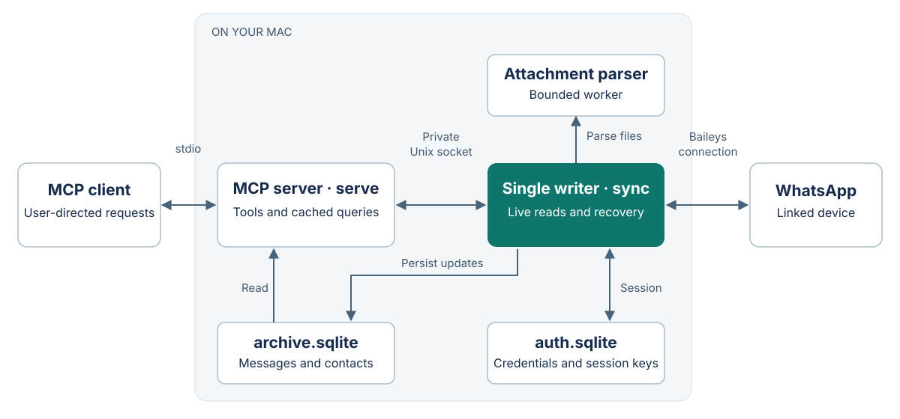

# WhatsApp MCP

Read WhatsApp conversations and attachments through a local MCP server. Find the chat the user names, read its latest received messages, search the archive, or request missing history. An optional agent skill transcribes voice notes locally.

The connector supports account-wide access or an exact list of selected chats. It has no tools for sending messages or marking them read.

## Architecture



Keep one `sync` process running. Your MCP host starts a separate `serve` process. Live reads check the WhatsApp connection; cached searches read the local archive. History delivery depends on WhatsApp, so a connected session can still have gaps.

Built with TypeScript, Node.js, SQLite, Baileys and the official MCP SDK. See the [technical design](docs/DESIGN.md) for module responsibilities and dependency choices.

## Setup

Requires Node.js 24+ on macOS and npm. Voice transcription also needs an existing Apple Silicon speech environment.

```sh
npm ci --ignore-scripts
npm run check
node dist/cli.js init
```

`init` creates `config.json` and a private local archive. New configurations use account-wide access. To restrict storage and reads to selected chats, use [config.example.json](config.example.json) and set `allowedChats` before syncing. [Configuration reference](docs/OPERATIONS.md#configuration).

Link once, after the account owner approves persistent access through the unofficial Baileys client:

```sh
node dist/cli.js link --accept-unofficial-client --config /absolute/config.json
```

After linking, reuse the saved session on subsequent starts:

```sh
node dist/cli.js sync --config /absolute/config.json
```

The active `link` process already runs sync. Stop it before starting another writer.

## Connect an MCP client

Register this stdio command in your MCP host, using absolute paths:

```sh
node /absolute/whatsapp-mcp/dist/cli.js serve --config /absolute/config.json
```

Resolve a conversation with `list_chats`, then call `read_conversation` with `requestHistory: false`. Use `read_attachment` for attached files. The [usage guide](docs/USAGE.md) covers all nine tools, pagination and missing-history recovery.

Account credentials and message data stay in the configured local data directory. Treat that directory as private. See [security and data handling](SECURITY.md) before sharing diagnostics or backups.

## Guides

| Task | Guide |
| --- | --- |
| Read chats, attachments or missing history | [Usage](docs/USAGE.md) |
| Configure, register, restart or troubleshoot | [Operations](docs/OPERATIONS.md) |
| Change code, run tests or update dependencies | [Development](docs/DEVELOPMENT.md) |
| Understand the processes and trust boundaries | [Technical design](docs/DESIGN.md) |
| Transcribe English or Spanish voice notes | [Agent skill](.agents/skills/whatsapp/SKILL.md) |
