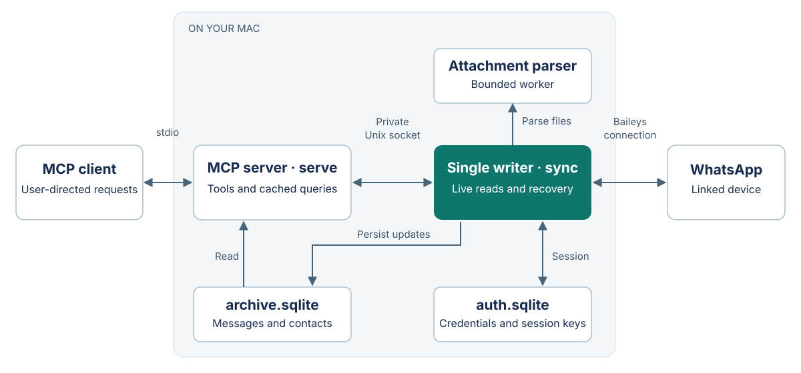

# Connected reading contract

A successful live read must verify the current authenticated WhatsApp connection, recheck chat authorization, and return all locally received updates for the requested page. It must disclose historical gaps. The linked-device protocol does not offer a guaranteed arbitrary query of the phone's entire message database.

For setup and process management, use [operations](OPERATIONS.md). For tool calls and pagination, use [usage](USAGE.md).

## Technology

| Layer | Implementation | Reason |
| --- | --- | --- |
| Runtime | Node.js 24+, ESM TypeScript, strict compiler settings | Native SQLite, worker threads and stream cancellation |
| WhatsApp | Baileys 7.0.0-rc14, guarded patches in `scripts/patch-baileys.mjs` | Linked-device events, media and history requests with reviewed transport behavior |
| MCP | Official split server/client SDK 2.3.0, Zod schemas | Modern stdio discovery and tested legacy compatibility |
| Storage | Node `node:sqlite`, account-bound archive schema 3, separate auth database | Durable received history and explicit account ownership |
| Local transport | Private Unix socket, validated JSON requests | Keep socket lifecycle and live operations in one writer |
| Document parsing | PDF.js and native canvas, ExcelJS, JSZip, SAX XML parser, image-size | Bounded PDF/image previews and extracted document content |
| Optional speech | Local MLX Whisper large-v3, Python and FFmpeg | Offline voice transcription on Apple Silicon |

Exact dependency versions and integrity hashes live in [package.json](../package.json) and [package-lock.json](../package-lock.json). The native runtime and canvas installation have been validated on macOS. Other platforms are not covered by the recorded live acceptance.

## Design alternatives

A single socket-owning MCP would simplify startup but mix credentials, reconnect lifecycle and arbitrary dependency capabilities into the model-facing process. An isolated offline MCP provided strong separation but could not request missing data and failed the intended user experience.

The chosen design retains one socket-owning sync service and adds private local IPC with three validated operations: conversation read, explicit directional history recovery and attachment read. `connected.ts` owns freshness, on-demand retrieval and revalidation. `live.ts` owns framing, bounds, errors and socket lifecycle. MCP tools never return credentials or raw download descriptors. SQLite indexes received history, whose completeness remains unknown.

## Invariants

- Account-bound archive; account or selected-chat authorization checked before network requests and after asynchronous work. Account scope retains available conversation data and supports any user-directed chat; selected scope applies an exact allowlist.
- One sync writer; no socket replacement during a successful live read. Authenticated ping response is required.
- Live errors are distinct from empty results. Requesting history does not establish delivery or completeness.
- Chat-scoped history requests are bounded and throttled by chat, direction and actual anchor. Recent recovery is explicit and works with full cached pages. Anchorless requests never invent message IDs. Account mode permits throttled full-account recovery after a stalled/refused recent or empty-chat request; selected mode does not. The account-wide cooldown survives process restarts. User approval for full-history recovery and account-wide user-directed reading precedes enabling account mode.
- Full history batches delivered by WhatsApp are accepted by the sync adapter, then filtered before content persistence.
- Stable message IDs, deduplication, edit revisions and deletion tombstones remain archive-owned.
- Attachment source descriptors are scoped to configured authorization, schema-migrated transactionally, and invalidated by edits/deletions. They are never exposed through MCP.
- Attachment reads accept IDs and section selectors, never filesystem paths or URLs. Downloads and parsing are bounded; macros and document scripts are not executed. Images and PDF previews are returned as image content, documents as extracted content.
- No application message sending, read marking, presence or account/group management. Protocol acknowledgments and history synchronization remain necessary.

## Ownership and verification

| Module in `src/` | Responsibility |
| --- | --- |
| `cli.ts`, `config.ts` | CLI startup, validated configuration and access policy |
| `sync.ts`, `auth.ts`, `wa-version.ts` | Single linked session, credentials, Web-version resolution and reconnect lifecycle |
| `normalize.ts`, `contacts.ts`, `contact-recovery.ts` | Message normalization, contact metadata and bounded contact recovery |
| `archive.ts` | Persistence, account binding, authorization, revisions, coverage and cursors |
| `history.ts`, `connected.ts` | Recovery coordination, live freshness and asynchronous revalidation |
| `live.ts` | Local IPC framing, bounds, cancellation and socket lifecycle |
| `media.ts`, `attachments.ts`, `attachment-worker.ts` | Bounded download/decryption and isolated content parsing |
| `server.ts` | MCP schemas and structured/text/image results |

The strategic-code-design and code-comments skills guide implementation and review. Review requests use the exact personal review rubric. Tests verify changed contracts, including revocation during asynchronous reads, stale-socket rejection, newest-first pagination with chronological presentation, actual document/image parsers, and real MCP stdio clients. Live acceptance remains separately documented; synthetic success is not proof of recovered phone history.

## History pagination and recovery

Archive pagination and upstream recovery have different contracts. A conversation cursor points to an older boundary in the received archive, including stable ordering of timestamp ties. `hasMoreLocal` reports stored continuation. An empty page retains the supplied cursor so a late batch can be read at that boundary. Cursor validation is chat-bound, bounded before decoding, and consistent for malformed/negative inputs. Search filter fingerprints canonicalize selected-chat order without bypassing authorization changes.

`history.ts` owns bounded recovery state, per-boundary cooldowns, duplicate-request suppression and progress observation. `connected.ts` verifies socket liveness and authorization around that asynchronous work. A recent request omits an anchor and targets the current time. Older recovery resolves the cursor to a real authorized nondeleted message, rather than always asking before the archive's oldest row. Account-wide fallback requires the existing account-mode policy at the moment of dispatch. A delivered batch with no page change is distinct from recovered recent data.

Protocol failures, cancelled requests and connection replacements invalidate the operation. Status exposes only bounded metadata. Credentials and download descriptors are excluded from tool results. Tests use temporary synthetic archives. Live acceptance records counts and timestamps separately from private message bodies.
