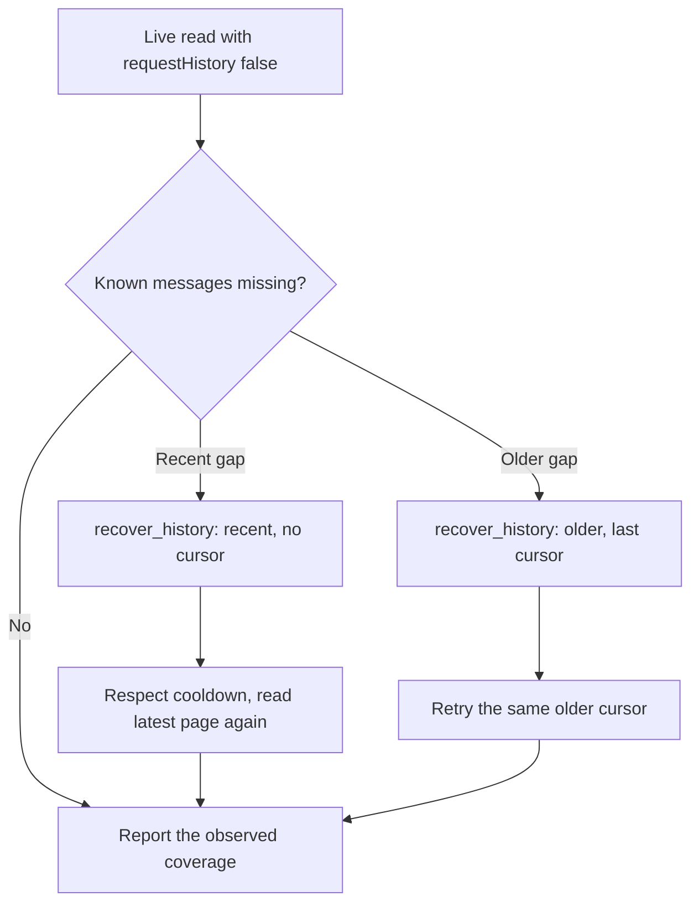

# Reading conversations and attachments

Start with the conversation the user requested. The sync process must be connected for live reads. MCP tool names below are logical names; a host may add its own namespace.

## A current conversation

1. Call `list_chats` with the requested name. Resolve ambiguous identities before reading content.
2. Call `read_conversation` with the resolved `chatId`, a `limit` of 1-100, and `requestHistory: false`.
3. Check `freshness`, the newest readable message and coverage. Report the observed endpoint in the user's timezone.
4. Inspect relevant attachments with `read_attachment`. A filename or caption does not establish the file's contents.

Calls use the discovered schema, for example:

```json
{
  "chatId": "<resolved chat id>",
  "limit": 50,
  "requestHistory": false
}
```

`freshness.checkedAt` records a successful WhatsApp server round-trip. It does not establish that every message from the phone arrived. A disconnected live read returns an error rather than silently returning a cached result.

## Tools

| Tool | Use | Data source |
| --- | --- | --- |
| `list_chats` | Resolve names, matched names and explicit PN/LID identities | Local metadata |
| `read_conversation` | Latest stored page with a live connection check | Live-checked archive |
| `recover_history` | Request recent or older history, including when a page is full | Phone request and archive |
| `read_attachment` | Read an authorized message's attachment by stable ID | On-demand download |
| `search_messages` | Literal text and time filtering, oldest first | Local archive |
| `conversation_context` | Messages around a stable message ID | Local archive |
| `sync_coverage` | Received counts, timestamp bounds and sync observations | Local archive |
| `list_selected_chats` | Compatibility listing for the configured scope | Local metadata |
| `get_media` | Legacy access to optionally cached media bytes | Local media cache |

Name matching ignores case, accents and repeated whitespace. Message search uses SQLite's ASCII case folding. A shared `identityId` records an explicit phone-number ID (PN) / linked ID (LID) mapping; it does not merge chat histories or authorization.

## Pagination

| Operation | First page | Next page | Display order |
| --- | --- | --- | --- |
| `read_conversation` | Latest received messages | Older messages | Chronological within each page |
| `search_messages` | Oldest matching messages | Newer matching messages | Chronological |

Pass `nextCursor` unchanged with the same chat or search filters. Conversation cursors and search cursors are different formats. Deduplicate combined pages by stable `id`.

`hasMoreLocal` describes older messages already stored. An empty conversation page preserves its input cursor so delayed backfill can be retried. Cursors do not freeze the archive: after recent recovery, restart without a cursor to see newly received messages.

Message `timestamp`, `after` and `before` values use Unix seconds. Freshness, heartbeat and history diagnostics use milliseconds. Search time bounds are inclusive. Coverage always reports `complete: false`; blank or unsupported records can extend stored bounds without adding readable text.

## Missing history



For a recent gap, call `recover_history` with:

```json
{
  "chatId": "<resolved chat id>",
  "direction": "recent",
  "limit": 100
}
```

For older history, use `direction: "older"` and the last conversation `nextCursor`. The request uses that real stored message as its anchor. A missing or deleted anchor fails instead of inventing a message ID.

Inspect `history.state`, `historyObserved`, `addedMessages`, `pageChanged`, `retryAfterMs` and `accountRetryAfterMs`. A received batch can contain older messages while a known recent gap remains. `addedMessages` counts the net increase in nondeleted records; `pageChanged` compares the page at the original `requestedLimit`.

Identical recovery requests share an in-flight request and a 60-second cooldown. Account mode can fall back to a full-account history request after an anchorless request stalls or is refused. That fallback has a 15-minute cooldown persisted across sync restarts. Selected mode never requests full-account recovery.

The legacy `requestHistory: true` option defaults on in `read_conversation` and requests older history only when the cached page is short. Use explicit recovery for a known gap. Restarting or relinking does not guarantee history delivery.

## Attachments

Call `read_attachment` with the stable message `id`, not a protocol `sourceId`, path or URL. It works with `cacheMedia: false`. PDF/text `page` and spreadsheet `startRow` start at 1. `sheet` selects a worksheet by name.

| Format | Returned content |
| --- | --- |
| PDF | Text and an image for one requested page, plus page count |
| PNG, JPEG, GIF, WebP | Image preview; animation is not preserved |
| XLSX, CSV | Sheet metadata and bounded cells/rows; formulas are not executed |
| DOCX | Text sections; layout and embedded images are not reproduced |
| TXT, Markdown, JSON, TSV, log | Paginated text |

Downloads are limited to 25 MiB. Parsing has a 20-second budget, a 64 MiB expanded-ZIP limit and a 40-megapixel image limit. Previews have a maximum long edge of 1,600 pixels. Spreadsheet pages show up to 100 rows and 50 columns, with truncation reported. The full live operation has a shared 60-second deadline.

Password-protected, damaged, expired and unsupported files return explicit errors. Legacy XLS/DOC, view-once content, media reupload and video transcription are unsupported. Voice transcription is a separate [local skill workflow](../.agents/skills/whatsapp/references/voice-notes.md).
